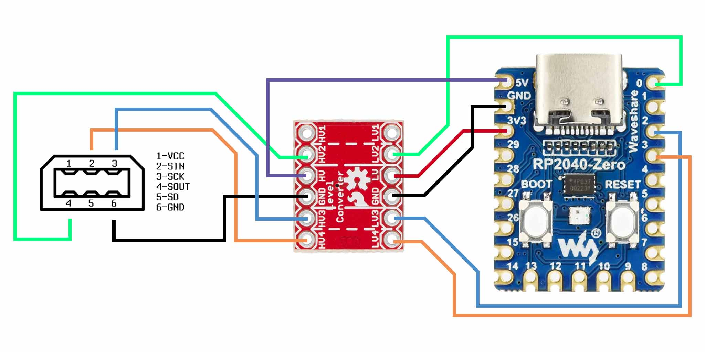
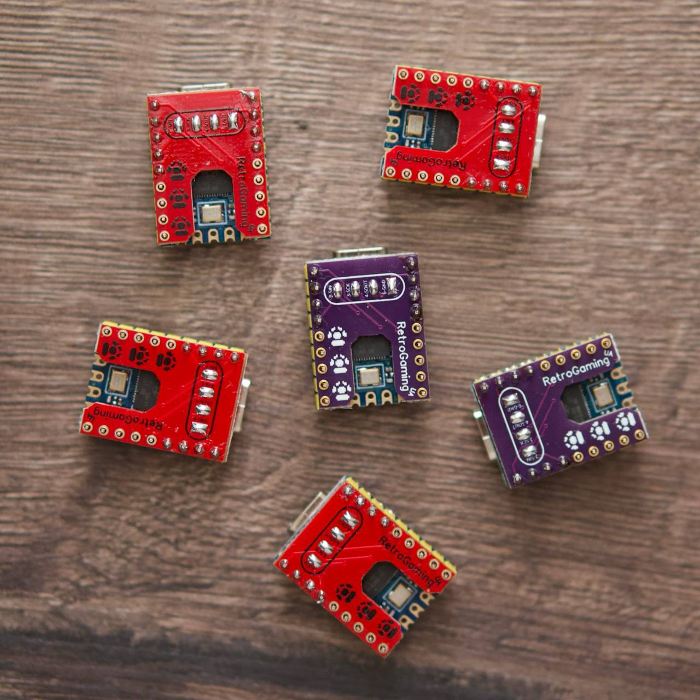

<p align="center">
  
</p>

<p align="center">
  
  
  
</p>

<p align="center">
  <b>A modern adapter to save GameBoy Camera photos to your PC or Phone via Web Interface.</b>
</p>

---

### 📸 Features

<div align="center">
<table>
  <tr>
    <td align="center"><b>🖼️ Web Gallery</b><br>Real-time photo receiving, kept across reloads</td>
    <td align="center"><b>🎨 Color Palettes</b><br>Retro GB & GBC styles, or your own</td>
  </tr>
  <tr>
    <td align="center"><b>🖨️ Printer Mode</b><br>Pictures, text and QR labels, banners</td>
    <td align="center"><b>📱 Mobile Ready</b><br>iOS & Android Support</td>
  </tr>
  <tr>
    <td align="center"><b>🎞️ Animations</b><br>GIF or video from your photos</td>
    <td align="center"><b>🗂️ Contact Sheets</b><br>All your photos on one page</td>
  </tr>
</table>
</div>

### 🚀 Getting Started

1.  **Build or Buy**: Get a Raspberry Pi Pico and follow the [Schematics](#-schematics) below.
2.  **Flash**: Download the latest `.uf2` from [Releases](https://github.com/antoxa2584x/gameboy-camera-adapter/releases) or [build it yourself](#-docker-build).
3.  **Connect**: Plug it into your PC/Phone. It will appear as a USB Ethernet device.
4.  **Open**: Navigate to **[http://192.168.7.1/](http://192.168.7.1/)** in your browser.
5.  **Update**: From v2.3.0 on, new firmware installs in one click: tap **Update available** (or **Settings → Firmware Update**) in the web UI, on any device including iPhone/iPad, or in the Android app. The browser or app downloads `update.bin` from the release, and the adapter checks it before installing. Updating *to* v2.3.0 is still the manual `.uf2` drag-and-drop.

---

### 🛠️ Compatibility Modes

The adapter features two specialized modes to ensure it works across all your devices. Switch via Web UI Settings or Serial commands.

*   **🍏 iOS + Desktop (Default)**: Optimized for Apple devices. Prioritizes the Web Interface.
*   **🤖 Android + Desktop**: Enables USB Serial (CDC) for use with the [Android Companion App](https://github.com/antoxa2584x/gameboy-camera-adapter-companion).

#### ⌨️ Serial Commands
If the web UI is unreachable, use a serial terminal to send:
*   `GET /set_mode_ios` / `GET /set_mode_android`
*   `GET /update` (Reboots to Bootloader)

---

### 📟 Modes of Operation

#### 📥 Scanner Mode (Default)
Acts as a virtual **Game Boy Printer**. Simply select "Print" on your Game Boy, and photos will appear instantly in the web gallery.

With [gb-photo](https://github.com/untoxa/gb-photo) the adapter also takes **Transfer** / **Transfer all** (fast raw transfers of the camera roll) and **Print all**. **Transfer REC** opens a live view in the web UI that you can save as an animated GIF or video, or grab single frames from.

Photos stay in the gallery until you delete them, even after a reload. Tap **Select** to save several at once (one ZIP file), print them, join them into one tall picture, turn them into a GIF or video, or lay them out on a contact sheet. Open a photo to rotate, flip or favorite it. Pick a palette above the gallery, or tap **+** to make your own (up to 3, saved on the adapter) and share it as a code. **Settings → Frame** keeps or removes the Game Boy Camera frame. Photo size, format, frame and Save All are kept on the adapter, so every browser and phone uses the same ones.

#### 📤 Printer Mode
Open the **Printer** tab at the top of the page, then pick what to print: a **Picture** from your device, or **Text or QR** for a label. The preview shows exactly what comes out of a real Game Boy Printer connected to the adapter. Choose a layout (Fit, Fill, Actual size, or Long for banners), set the darkness, and print. Add more pictures or labels to print several in a row, with copies; **More options** has shading styles, brightness and contrast. If the printer jams or runs out of paper, fix it and tap **Resume**.

---

### 🔌 Schematics

<p align="center">
  
</p>

#### 💡 Hardware Tips
*   Uses **GPIO 8** for the Status LED.
*   Uses **GPIO 9** for the Action Button.
*   Requires a **5V to 3.3V level shifter** for safe operation with the Game Boy's 5V logic.

<p align="center">
  
  <br><i>Example of a finished build.</i>
</p>

---

### 🐳 Docker Build

Build the firmware without installing any local dependencies:

```bash
git clone --depth 1 https://github.com/antoxa2584x/gameboy-camera-adapter
cd gameboy-camera-adapter
git submodule update --init
./build.sh
```

---

### 🤝 Credits & Links
*   Based on [pico-gb-printer](https://github.com/untoxa/pico-gb-printer).
*   Protocol insights from [Raphael-Boichot](https://github.com/Raphael-Boichot/The-Arduino-SD-Game-Boy-Printer).
*   [RetroGaming UA](https://rgaming.com.ua/)
